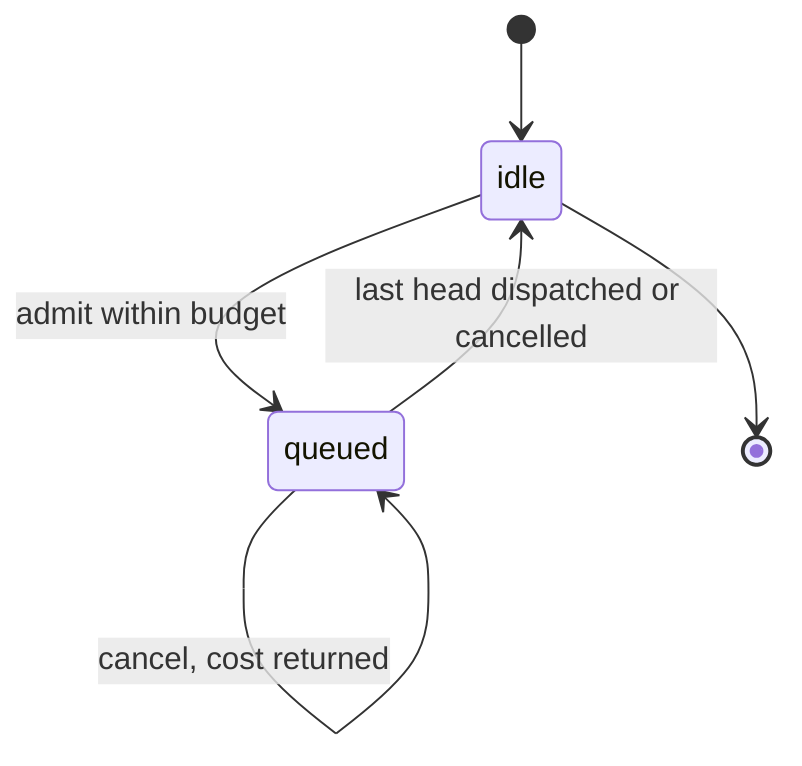
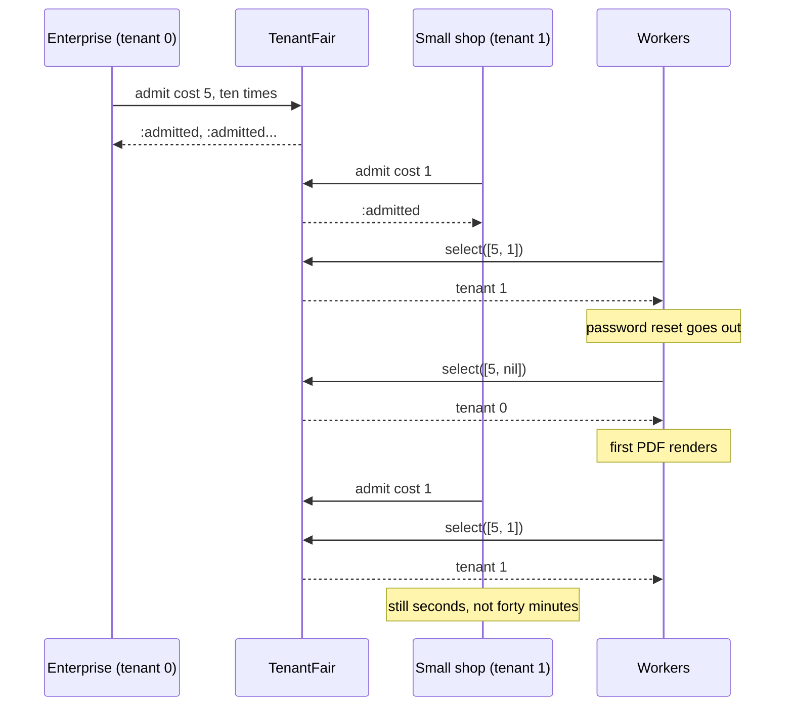

# FairMachines

> One tenant with ten thousand jobs should not make every other tenant wait ten thousand jobs. ⚖️

Cost-aware fair scheduling for Ruby. You give each tenant a budget for how much work it may have queued and a share of each dispatch round. `TenantFair` tells you whose job goes next, charges the tenant for its cost, and refuses to admit work past the budget. The loud tenant still gets served. It just doesn't get served *instead of* everyone else.

## Quick Start

```bash
gem 'fair_machines'
```

```ruby
# Two tenants. Each may have 100 units of work queued; each gets 2 units per round.
fair = FairMachines::TenantFair.new([100, 100], [2, 2])   # capacities, quanta

# Enterprise tenant enqueues ten PDF exports at cost 5. Small tenant queues five emails at cost 1.
10.times { fair.admit(0, 5) }   # => :admitted   (tenant, cost)
5.times  { fair.admit(1, 1) }

# Each round, tell the scheduler the cost at the head of every tenant's queue.
# It answers with the tenant whose head runs now. You pop that job and run it.
fair.select([5, 1])   # => 1   the email goes first
fair.select([5, 1])   # => 1
fair.select([5, 1])   # => 1
fair.select([5, 1])   # => 1
fair.select([5, 1])   # => 0   the PDF has saved up enough share
```

Tenants are indices into the arrays you passed in. Heads are the cost of each tenant's next job, or `nil` when that tenant has nothing waiting.

## A Message to the Resistance

So you built the job queue. Priorities, retries, a dashboard. Then your biggest customer clicked "export everything" and ten thousand PDF jobs landed in the queue at once, and for the next forty minutes nobody else's password reset email went out.

You added a second queue for the big customer. Then a third for the next big customer. Then a priority flag that every customer's jobs somehow ended up setting. None of it fixes the actual problem, which is that the queue has no idea what a tenant is, let alone how much of the worker pool that tenant has already consumed.

Fairness is two numbers per tenant. How much work may this tenant have waiting at once, and how big a slice of each round does it get. With those, a ten-thousand-job export gets a fixed share of the workers and the password reset goes out in seconds, because the small tenant's slice is sitting there unused.

This gem keeps those two numbers honest. You keep the queues.

## Chapter 1: Stardate 2025.186, the AMS Shreedhar

> **AMS Shreedhar**, NCC-4207, *Shreedhar*-class convoy escort.
> The flagship does not get to spend every tenant's fuel allowance.

The escort doesn't fly the convoy. It holds the fuel ledger: how much each ship may have on request at once, and how much is pumped to each per cycle. A ship with a loud captain and a long manifest still draws from its own allowance, charged by the actual mass of what it asked for. A dinghy asking for one pallet gets its pallet on the next cycle.

Somewhere on the bridge, a junior officer suggests:

```ruby
def next_job
  queue.shift   # it's a queue, first come first served, that's fair, right?
end
```

"That," says the convoy master, "is how a dinghy starves behind a freighter."

## The Flight Plan

Each tenant is either idle or has cost queued. Admission moves cost in, dispatch and cancellation move it out, and a full budget turns new work away. A refusal moves nothing.



And the afternoon the enterprise tenant clicked "export everything":



## How the Ledger Works

### Admit

Before a job is enqueued, ask whether the tenant has room for its cost. `:admitted` means it does and the cost is now on the ledger. Anything else is a refusal, and the job doesn't go on the queue.

```ruby
fair = FairMachines::TenantFair.new([10, 5], [3, 1])

fair.admit(1, 5)     # => :admitted        budget 5, now full
fair.admit(1, 1)     # => :insufficient    over budget
fair.admit(2, 1)     # => :unknown_tenant  no such tenant
fair.in_flight(1)    # => 5
fair.available(1)    # => 0
fair.tenant_count    # => 2
```

Over-budget is a refusal, not an error. Decide what to do with the job: reject it, hold it, tell the tenant. Every answer is a symbol and every symbol is truthy, so don't write `if fair.admit(...)`. Compare against `:admitted`.

### Select

Each round, pass the head cost of every tenant's queue. You get back the tenant whose head runs now, or `nil` when nobody is eligible. The chosen tenant is charged that cost against its budget, so the room comes back as the work drains.

```ruby
fair = FairMachines::TenantFair.new([10, 5], [3, 1])
fair.admit(0, 4)
fair.admit(1, 1)

fair.select([4, 1])       # => 1
fair.select([4, nil])     # => 0
fair.select([nil, nil])   # => nil   both queues are empty
fair.admit(0, 7)          # => :admitted   the dispatched 4 freed its room
```

`nil` means one thing: every head you passed was `nil`.

Heads have to be truthful. A head that costs more than its tenant has admitted was never admitted, so it can't be dispatched. `select` refuses the whole round with `:exceeds_in_flight` and changes nothing, rather than quietly skipping that tenant and leaving you to wonder why its jobs never run.

```ruby
fair.select([8, nil])     # => :exceeds_in_flight   tenant 0 only admitted 7
fair.select([7, 1])       # => :exceeds_in_flight   tenant 1 admitted nothing
fair.select([7, nil])     # => 0
```

### Share is by cost, not by count

Quanta are how much cost each tenant may dispatch per round, with leftover carried to the next round. A tenant whose head is expensive waits until it has saved up. A tenant with cheap jobs runs one every round.

```ruby
fair = FairMachines::TenantFair.new([50, 50], [2, 2])
fair.admit(0, 40)   # heavy jobs at cost 4
fair.admit(1, 10)   # light jobs at cost 1

Array.new(10) { fair.select([4, 1]) }
# => [1, 1, 0, 1, 1, 1, 1, 0, 1, 1]
```

Same quanta, same share of the pool, and the light tenant still dispatches four jobs for every one heavy job, because the heavy job costs four times as much.

Give one tenant a bigger quantum and it gets a bigger share of the pool outright:

```ruby
fair = FairMachines::TenantFair.new([20, 20], [3, 1])
fair.admit(0, 20)
fair.admit(1, 20)

Array.new(8) { fair.select([1, 1]) }
# => [0, 0, 0, 1, 0, 0, 0, 1]
```

### Cancel

A job that leaves the queue without being dispatched has to give its cost back, or the tenant's budget leaks until nothing is admitted.

```ruby
fair = FairMachines::TenantFair.new([10, 5], [3, 1])
fair.admit(0, 4)

fair.cancel(0, 4)         # => :cancelled
fair.cancel(0, 1)         # => :exceeds_in_flight  nothing left to cancel
fair.select([nil, nil])   # => nil                 the queue is empty, and so is the ledger
```

Cancelling more than was admitted is refused, and the ledger is untouched. The ledger counts cost, not jobs: it can't tell a cancel you sent twice from two jobs of the same cost. Cancel each job once.

### Too many tenants to name: `KeyedFair`

Sixteen tenant slots is a crew roster. Orgs, API keys and IP prefixes are a starfield. `KeyedFair` hashes each key onto a fixed set of lanes, every lane with its own budget and no queue. A loud org fills its lane and gets `:insufficient`; the other lanes don't notice. Keys that hash to the same lane share its budget, so pick enough lanes that a collision is rare.

```ruby
fair = FairMachines::KeyedFair.new(64, 8)   # lanes, capacity per lane

hash = org_id.hash & 0xFFFF_FFFF_FFFF_FFFF  # hashes are unsigned 64-bit
lane = fair.admit(hash, 1)   # => #<data FairMachines::Lane index=17>, or :insufficient
# ... do the work ...
fair.release(lane, 1)        # => :released
```

Any lane count from 1 to 256 works. `admit` hands back the `Lane` it charged so you don't hash twice. A lane is just a bucket number wrapped in a `Data`: the same hash lands in the same lane every time, in every `KeyedFair` with as many lanes, and you can ask for one without admitting anything.

```ruby
FairMachines::KeyedFair.lane(64, hash)    # => #<data FairMachines::Lane index=17>
FairMachines::KeyedFair.lane_at(64, 63)   # => #<data FairMachines::Lane index=63>
FairMachines::KeyedFair.lane_at(64, 64)   # => nil
fair.in_flight(lane)                      # => 0
fair.release(FairMachines::Lane.new(64), 1)   # => :unknown_lane
```

## The Rules of the Escort

- **Ruby mirrors the Rust core.** Arguments are positional, in the core's order: `TenantFair.new(capacities, quanta)`, `admit(tenant, cost)`, `KeyedFair.new(lanes, capacity)`. `Lane` is a `Data` with an `index`. Where the core has a function on the type, `KeyedFair::<LANES>::lane(hash)`, Ruby has a class method that takes the lane count first: `KeyedFair.lane(lanes, hash)`.
- **Every answer, by method.**

  | Method | Honoured | Refused |
  | --- | --- | --- |
  | `TenantFair#admit(tenant, cost)` | `:admitted` | `:unknown_tenant`, `:insufficient` |
  | `TenantFair#cancel(tenant, cost)` | `:cancelled` | `:unknown_tenant`, `:exceeds_in_flight` |
  | `TenantFair#select(heads)` | the tenant to dispatch (Integer), `nil` exactly when every head is `nil` | `:exceeds_in_flight` |
  | `TenantFair#in_flight(tenant)`, `#available(tenant)` | Integer, `nil` for an index that is not a tenant | never refuse |
  | `KeyedFair#admit(hash, cost)` | the `Lane` charged | `:insufficient` |
  | `KeyedFair#release(lane, cost)` | `:released` | `:unknown_lane`, `:exceeds_in_flight` |
  | `KeyedFair#in_flight(lane)`, `#available(lane)` | Integer, `nil` for a lane this instance does not have | never refuse |
  | `KeyedFair.lane(lanes, hash)` | a `Lane` | never refuses |
  | `KeyedFair.lane_at(lanes, index)` | a `Lane`, `nil` for an index of `lanes` or more | never refuses |
  | `tenant_count`, `lane_count` | Integer | never refuse |

  Every refusal has its own symbol; there is no catch-all. No method takes a time, so no answer records a clock.
- **A refusal never raises and changes nothing.** Not a budget, not a tenant's saved share, not whose turn it is.
- **1 to 16 tenants**, set by the length of `capacities`; `quanta` must be the same length. Empty, longer, or mismatched arrays raise `RangeError`. The tenant count is the core's const generic `N`, and the core has no ceiling of its own: `TenantFair::MAX_TENANTS`, 16, is the largest `N` compiled into the binding.
- **1 to 256 lanes**, any count, not only powers of two. Outside that is `RangeError`. The lane count is the core's const generic `LANES`; `KeyedFair::MAX_LANES`, 256, is the largest compiled into the binding.
- **Wrong type is `TypeError`, wrong value is `RangeError`,** and the message names the argument (`tenant must be an Integer`, `cost must be in 1..=4294967295`). `ArgumentError` is Ruby's own, for the wrong number of arguments.
- **Capacities, quanta, and costs are positive Integers** below `2**32`. Zero, negative or too large is `RangeError`; floats and strings are `TypeError`. Nothing is rounded for you.
- **Hashes are Integers** in `0...2**64`; **tenant indices** are Integers a `usize` holds (`0...2**64` on a 64-bit platform, `0...2**32` on a 32-bit one). Negative or too large is `RangeError`. Ruby's `#hash` can be negative: mask it, as above. A tenant index past the last tenant doesn't raise; it's `:unknown_tenant`.
- **Heads are exactly `tenant_count` entries**, each a positive Integer or `nil`. The wrong length or a zero raises `RangeError`, a float `TypeError`, before anything changes.
- **`release`, `in_flight` and `available` on a `KeyedFair` take a `Lane`**, not a bare Integer. Anything else is `TypeError`.
- **A `Lane` is valid or does not exist.** `Lane.new(index)` is the core's `Lane::new(index)`: an Integer a `usize` holds, `TypeError` for anything else, `RangeError` outside the range. One you build by hand is held to the same rule as one `admit` returned. `Lane` is sealed: subclassing it raises `TypeError` and `allocate` is gone. That stops accidents, not reflection, so the binding checks too: a lane it reads must be an instance of exactly `Lane` (`TypeError` otherwise) and its index is re-checked (`RangeError`), so a lane forged with `Data#initialize` or `Marshal` never reaches the core.
- **The binding never loses work.** Everything that can raise happens before the core is called. `admit` charges a copy, builds the `Lane` it answers, and keeps the copy only if the `KeyedFair` is still unfrozen and unchanged: if building the lane raises, freezes it (`FrozenError`) or calls back into it (`RuntimeError`), nothing is charged.
- **A `Lane` is a bucket, not a ticket.** Nobody issued it and it proves nothing: anyone can build one, and two `KeyedFair`s with the same lane count agree on every lane. That's the point of hashing. Keep separate things in separate `KeyedFair`s and don't mix their lanes up.
- **Repeats aren't recognised.** `cancel` and `release` count cost, so a second one is honoured while cost remains and `:exceeds_in_flight` after. There are no ids, so nothing survives a restart either: a new ledger starts empty.
- **Frozen means frozen.** `freeze` either object and `admit`, `cancel`, `select`, and `release` raise `FrozenError`. Readers still answer.
- **A tenant that drains to empty loses its saved-up share.** Leftover quantum doesn't accumulate for a tenant with nothing queued, and a tenant you present as `nil` to `select` is treated the same.

## What You Think You're Doing vs Reality

### You Think: "Round robin between tenants. Everybody gets a turn."
### Reality: A turn is not a share. One tenant's turn is a thumbnail, another's is a 40-page PDF.

Taking turns by job count hands the pool to whoever submits the heaviest jobs. Fairness has to be measured in what a job costs, which is why every call here carries a cost and why the scheduler charges it before it hands out the next turn.

## What's Yours

The scheduler is a ledger, not a queue. You keep a queue per tenant, call `admit` before you push and push only on `:admitted`, hand `select` the cost at the head of each queue, and pop the job from the tenant it names. Your cost estimates have to be honest, because the ledger believes them. And when a job dies on the floor without running, call `cancel`, or the tenant pays for it forever.

## License

MIT License. See [LICENSE.txt](LICENSE.txt) for details.

**Remember: The export job will finish. The question is whether the password reset has to wait for it.**
